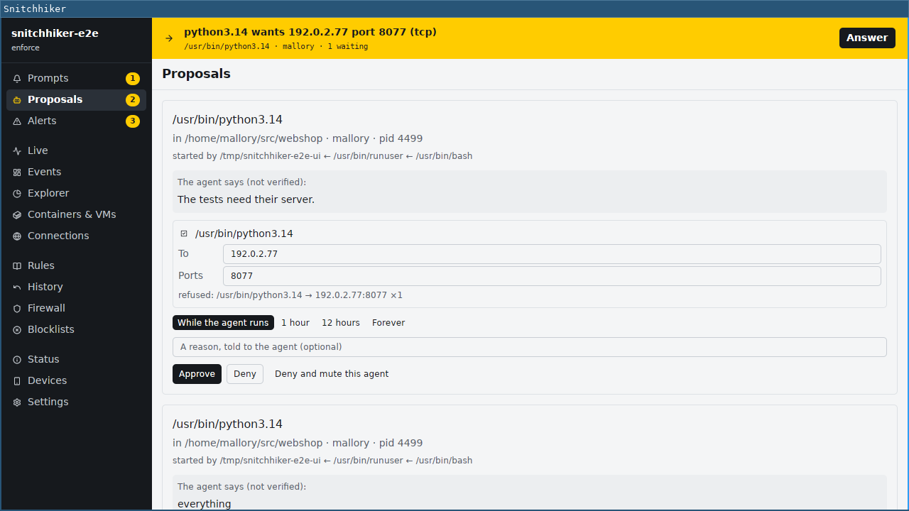

A coding agent (Claude Code, Codex and the like) runs commands that need the network now and then: a package registry, an API, a forge. Without help, all you see is a prompt for `node → 104.16.x.x:443` in the middle of something else. Snitchhiker lets the agent ask instead: through its MCP server the agent sees which of *its own* connections were refused, and **proposes** the narrow rules it needs, with a reason. You approve or deny in the desktop app; the agent is told, and goes on.

An agent can't change anything itself. Every proposal waits for a person.



## Registering the MCP server

The MCP server is part of the command line: `snitchhiker mcp`, run as you, by the agent. Register it with the agent so it starts it directly.

For Claude Code:

```sh
claude mcp add --scope user snitchhiker -- snitchhiker mcp
```

For Codex, in `~/.codex/config.toml`:

```toml
[mcp_servers.snitchhiker]
command = "snitchhiker"
args = ["mcp"]
```

For other clients that read the common JSON form:

```json
{ "mcpServers": { "snitchhiker": { "command": "snitchhiker", "args": ["mcp"] } } }
```

The node takes the process that started the MCP server to be **the agent**, and everything that process starts (the commands it runs, their children) to be its processes. So the agent must start `snitchhiker mcp` itself: through a shell script or a launcher, the launcher would be "the agent", and the agent's other commands not its processes.

The server speaks to the node's agent socket, `/run/snitchhiker/agent.sock`, which any local process may open. That is safe because of what the agent role can do: look, and propose. To accept proposals only from known agent programs, list them in [`agent_programs`](/reference/configuration/#agent_programs).

## What the agent can do

The [tools](/reference/mcp/) map onto the agent role's requests:

- **`recent_blocked`**: the connections of the agent's own processes that were refused, or are waiting for a prompt, over the last hour. Nothing else of the history: an agent never sees what the rest of the machine does.
- **`check_connection`**: how a connection would be decided now, and by which rule.
- **`propose_rules`**: rules to allow, and why.
- **`wait_for_proposal`**, **`get_proposal`**, **`withdraw_proposal`**: follow a proposal until you answer it.
- **`annotate_pending`**: add a note to a prompt its own process caused ("this is `npm install` fetching the project's dependencies"), shown with the prompt.

## What the node does with a proposal

The agent only suggests. Each proposed rule is **shaped** by the node before you see it:

- **The program is the one the kernel saw.** If the agent's processes were refused connections to those destinations, the rule names the program that made them, whatever the agent wrote (a symlink like `/usr/bin/python3`, or a launcher like `~/.cargo/bin/cargo`, becomes the real binary). Only when several programs were refused there does the agent's word pick one of them.
- **Broad rules are marked**: any destination, a wildcard on a public suffix (`*.com`, `*.co.uk`), any port with a broad destination, networks wider than a /24, the LAN and the cloud metadata service, binaries a user can replace, and rules nothing the agent tried matches (a guess). A rule for any program to anywhere is refused outright.
- **Evidence**: each rule lists the refused connections it would let through.
- **Already allowed**: a rule whose connections today's rules allow already is shown as such and not made.

Proposals have limits: 16 rules each, a reason of at most 2000 characters, 10 waiting per agent. The same rules proposed again return the proposal already waiting.

## Reviewing

Proposals come as a desktop notification and on the **Proposals** page. Each shows:

- **who proposed**, as the kernel says: the agent's program, its working directory (the project), the user, and what started it;
- **the agent's words**, set apart and labelled as not verified: it is text the agent wrote, and a prompt-injected agent can write anything;
- **the rules** as shaped, each with its marks and evidence. You can drop a rule, or narrow its hosts and ports, before approving.

Then choose how long, and **Approve** or **Deny**, with a reason if you like: the agent is told it.

- **While the agent runs** (the default): the rules match only the agent's processes, and are removed when the agent exits. Another program of yours doesn't get them, nor does the next session of the agent.
- **1 hour**, **12 hours**, **Forever**: the rules apply to the program wherever it runs, until they expire.

Approving a marked rule asks for your password, as other [dangerous actions](/internals/security/#dangerous-actions-need-more-than-a-session) do. Approved rules go in the folder `Agents/<agent>/<project>`, as one change of the [history](/guides/rules/#history-and-undo), undone like any other.

A proposal still waiting when its agent exits expires.

From the command line, `snitchhiker proposals` lists those waiting, `snitchhiker proposals show <id>` shows one, and `snitchhiker proposals approve <id>` or `deny <id>` answers it ([reference](/reference/cli/)).

### Muting an agent

An agent that keeps proposing what you don't want can be muted: **Deny and mute this agent** (or `snitchhiker proposals deny <id> --mute`) denies the proposal and every later one from the same agent process and what it started, without asking you, until it exits. The agent is told each was denied.

## Envelopes

Some proposals you would approve every time: a build fetching from the package registries, in your own projects. An **envelope** approves those without asking. It says which projects (the agent's working directory), which hosts (names, and `*.name` for subdomains, never addresses), and optionally which ports and programs:

```sh
sudo snitchhiker envelopes add registries --project 'glob:{home}/workspace/**' \
  --host registry.npmjs.org --host crates.io --host '*.crates.io' --port 443
```

A proposal is approved by an envelope only when all of these hold; otherwise it waits for you as usual:

- it comes from one of the node's [`agent_programs`](/reference/configuration/#agent_programs) (any other program's proposals never are);
- every rule in it is inside the envelope: only host names it covers, on its ports, for its programs, and nothing else (no addresses, no other conditions);
- no rule has a mark other than "nothing the agent tried matches it" (a rule proposed before the agent was refused is fine inside the bounds you set).

Such approvals are for the agent's session only, are recorded in the [history](/guides/rules/#history-and-undo) as made by `envelope "<name>"`, and raise an alert, so you see what went through. Adding, changing or removing an envelope is a dangerous action: it asks for your password. Envelopes are listed under the proposals in the apps, and with `snitchhiker envelopes`.

## Good and bad proposals

`cargo build` refused on its way to the registry, and the agent proposes:

```json
{ "justification": "cargo build needs the crates of Cargo.lock.",
  "rules": [{ "exe": "/home/ada/.cargo/bin/cargo", "hosts": ["index.crates.io", "static.crates.io"], "ports": ["443"] }] }
```

It is shaped to the toolchain's `cargo` binary the kernel saw, unmarked, with the two refused connections as evidence: approve it, and the build goes on.

These come marked, or not at all:

| Proposed | What happens |
| --- | --- |
| `{"hosts": ["*"]}` with no program | refused: any program, anywhere |
| `{"exe": "/usr/bin/node", "hosts": ["*.com"]}` | marked: every site under a public suffix, any port |
| `{"exe": "/usr/bin/curl", "hosts": ["10.0.0.0/8"], "ports": ["443"]}` | marked: a wide network, and the LAN |
| `{"exe": "/usr/bin/python3", "hosts": ["169.254.169.254"]}` | marked: the cloud metadata service |
| `{"exe": "/usr/bin/wget", "hosts": ["example.org"], "ports": ["443"]}` with nothing refused | marked: a guess |

## What this doesn't protect against

- Any of your programs can open the agent socket and propose: it gains nothing a prompt wouldn't, since you approve. Its provenance shows what it is.
- An agent fooled by what it read can propose something harmful with a convincing reason. The shaping, the marks, the evidence and the session scope limit what a careless approval costs; reading what you approve is still on you.
