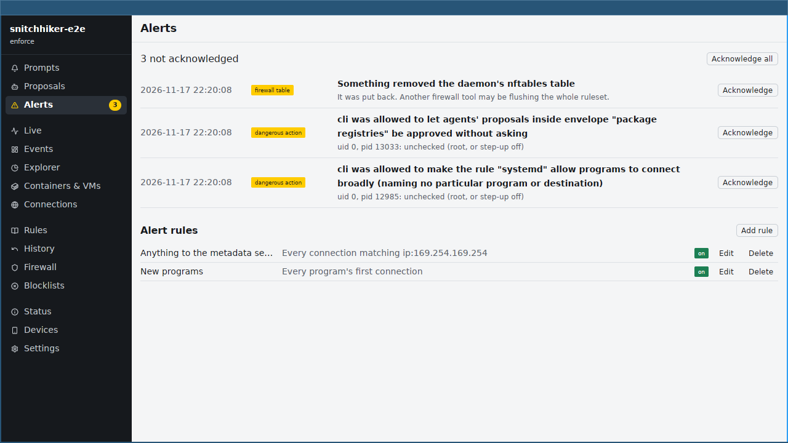

An alert is something worth looking at that doesn't need an answer now, unlike a prompt. Alerts are kept until the history's [retention](/reference/configuration/#retention_days), shown on the desktop app's **Alerts** page (with a desktop notification as they come), logged to the journal, and **acknowledged** once for every client: acknowledging on one device clears them everywhere.



## What the node raises by itself

| Alert | When |
| --- | --- |
| The daemon stopped unexpectedly | At start, when the last run didn't stop cleanly: it crashed, was killed, or the machine lost power. |
| Something removed an nftables table | Another tool deleted the daemon's table or the [system firewall](/guides/system-firewall/)'s (a `nft flush ruleset`, typically). The table is put back within ten seconds. |
| The kernel dropped packets waiting for a decision | The daemon's queues overflowed: new connections were refused while that lasted. |
| Connections weren't recorded | The database couldn't keep up, so some decided connections are missing from the history. |
| Reloading the rules failed | A rule file in `rules.d` is invalid; the rules from before stay in effect. |
| A dangerous action | A client was allowed one ([step-up](/reference/configuration/#step_up)): a rule allowing everything, a big deletion, loosening the policy, turning the system firewall off. |

## Alert rules

An alert rule watches the connections as they are recorded: those its [query](/reference/query-language/) matches, at least *N* of them within *W* seconds, raise an alert. After it fires, a rule stays quiet for its window (or a minute), so a burst gives one alert, not a hundred.

With **programs never seen before**, only the first connection of a program the node never recorded counts: a new tool, an update that moved a binary, something dropped in `/tmp`.

```bash
# Anything at all to the cloud metadata service
sudo snitchhiker alerts rules add "IMDS" --query "ip:169.254.169.254"
# More than 100 blocked connections in five minutes
sudo snitchhiker alerts rules add "Many blocks" --query "-action:allow" --threshold 100 --window 300
# Every program's first connection
sudo snitchhiker alerts rules add "New programs" --first-program

sudo snitchhiker alerts            # those not acknowledged
sudo snitchhiker alerts ack --all
```

## Webhooks

Besides the clients and devices, alerts can go to a webhook: chat, a pager, a log collector. Set [`alert_webhook`](/reference/configuration/#alert_webhook) to its URL; each alert is sent as JSON:

```json
{"node": "web-1", "id": 42, "time_ms": 1763200000000, "kind": "alert_rule", "title": "…", "body": "…"}
```

With [`alert_webhook_secret_file`](/reference/configuration/#alert_webhook_secret_file), each delivery is signed: `X-Snitchhiker-Signature: sha256=<hex>`, the HMAC-SHA256 of the body with the file's secret. The receiver computes the same and compares, to know the alert came from the node. Every alert is also in the system journal (`journalctl -u snitchhikerd`).
