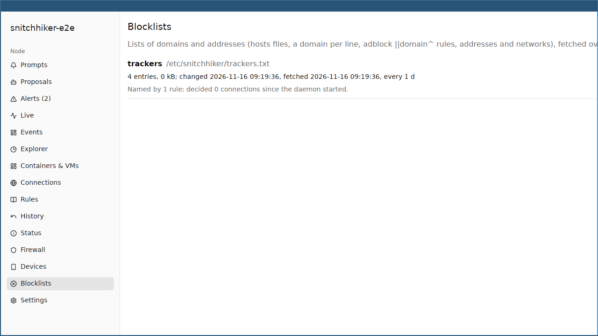

A blocklist is a list of domains or addresses kept up to date by someone else: ad and tracker lists, malware feeds, a team's own list on an internal server. The node fetches each list on a schedule, checks it, and keeps it; rules name it with the `list` condition.



## Adding a list

```sh
snitchhiker lists add ads https://raw.githubusercontent.com/StevenBlack/hosts/master/hosts
snitchhiker rules add deny --list ads --any-context --name "ads and trackers"
```

The first command fetches the list at once and then every day (`--every 12h` for another interval, at least `15m`). The second blocks everything on it, from the host and from containers and VMs alike. A list can also be a file on the node: `snitchhiker lists add ours /etc/snitchhiker/blocked.txt` reads it on the same schedule.

`list` is a condition like any other, so it combines with them. `--list ads --exe /usr/bin/firefox` blocks the list for Firefox only; an allow rule with a list (`--list partners --port 443`) allows what is on it. Be careful with the latter: whoever controls the list then decides what is allowed.

## What a list may contain

Each line is one of:

- a hosts file line, `0.0.0.0 ads.example.com tracker.example.com` (the address is ignored, and `localhost` and the like are skipped);
- a domain, `ads.example.com` or `*.ads.example.com`;
- an adblock domain rule, `||ads.example.com^` (rules with options, `$third-party`, or exceptions, `@@`, aren't domain rules and are skipped);
- an address or a network, `192.0.2.7`, `198.51.100.0/24`, `2001:db8::/32`.

`#` starts a comment anywhere on a line, `!` and `[` at its start. A domain matches itself and every name under it: `ads.example.com` also covers `eu.ads.example.com`. The connection's names are those the destination address is known by (see [rules](/guides/rules/)); a connection by address alone matches through the list's addresses and networks.

## Checks

A fetch replaces the list only when the new version passes these checks; otherwise the version before stays in use, and the error is shown with the list (and logged):

- **HTTPS only**: plain `http://` URLs aren't accepted, since anyone on the path could change the list.
- **Size**: at most [`blocklist_max_bytes`](/reference/configuration/#blocklist_max_bytes) (64 MiB by default).
- **Text**: the file must be UTF-8.
- **Format**: at least one entry, and no more than a tenth of its lines that aren't entries. A server's error page, a login page or a list in a format this doesn't read is refused rather than taken for an empty list.

A list whose fetch failed is tried again after an hour. Unchanged lists aren't downloaded again: the node sends the `ETag` the server gave (`If-None-Match`). Lists are kept in `lists/` next to the database, so after a restart without a network they still apply.

## Seeing what a list does

```sh
snitchhiker lists
```

```
ads  https://raw.githubusercontent.com/StevenBlack/hosts/master/hosts
    81234 entries (3412 kB), changed 3 h ago, fetched 3 h ago, every 1 d
    named by rule 12; decided 4021 connections since the daemon started
```

`snitchhiker lists refresh ads` fetches it now; `snitchhiker lists rm ads` deletes it, after which rules naming it match nothing through it. The desktop and phone apps show the same on their **Blocklists** page, where lists are added, fetched and removed too. The connections a list blocked are in the history like any other, with the rule that named it.
