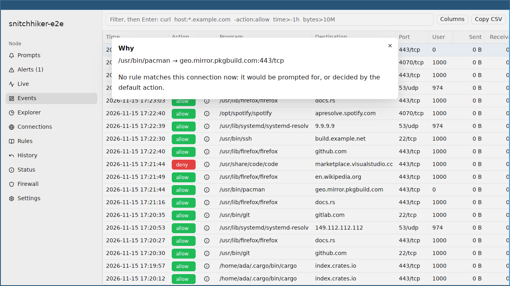

The desktop app's **Explorer** answers "what talked to what" over a time range: the connections of the last hour, day, week or month, grouped by **program**, **host**, **port** or **user**, busiest first, with how many were allowed and blocked and the bytes each way.

A row drills down: a program's row shows where it connected, a host's row which programs reached it. The path back is above the list. **Copy CSV** copies the rows shown.

The node answers from hourly totals it keeps as connections are recorded, so a month of a million connections groups in tens of milliseconds, as fast as an hour does. The totals go with the history after its [retention](/reference/configuration/#retention_days).

From the command line, `snitchhiker explore` gives the same groups:

```bash
sudo snitchhiker explore --by host --hours 168 --where program=/usr/bin/curl
```

## Live, Events and Explain

- **Live** shows connections as they happen: allowed and blocked each second of the last two minutes, the busiest programs of the last minute, and the newest connections (pause it to read them).
- **Events** is the history, newest first, filtered with the [query language](/reference/query-language/). Its info button (or a double-click) says why a connection was decided as it was: every rule that matches it under today's rules, the deciding one first.


