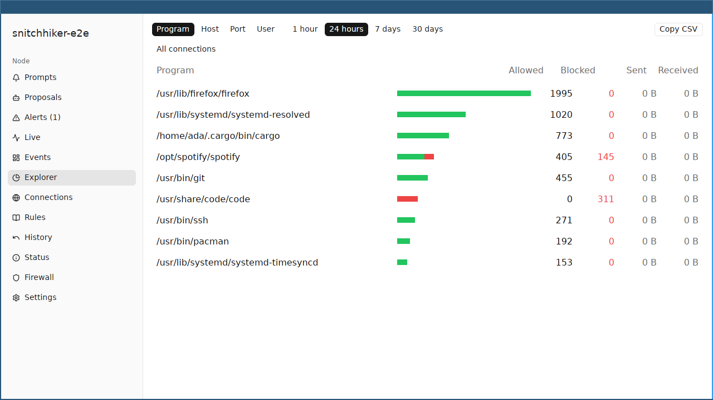

The desktop app's **Explorer** answers "what talked to what" over a time range: the connections of the last hour, day, week or month, grouped by **program**, **host**, **port** or **user**, busiest first, with how many were allowed and blocked and the bytes each way.

Each group's **trend** shows its connections over the range, an hour a bar (a day a bar beyond two days): a program that only talks at night, or a host that started yesterday, stands out. The command line draws it too.

A row drills down: a program's row shows where it connected, a host's row which programs reached it. The path back is above the list. **Copy CSV** copies the rows shown.

The node answers from totals it keeps as connections are recorded (by hour, day and week, and running totals of the last day, week and month), so a month of ten million connections groups in milliseconds, as fast as an hour does. The totals go with the history after its [retention](/reference/configuration/#retention_days).

**Container** groups by the container, VM or named namespace connections came from (the **Containers & VMs** page starts there); a container drills into its programs and hosts.

**By bytes** orders the groups by what they sent and received: the top talkers. **Compare with before** adds the period just before, as long: each group's count then, or **new** for a group that wasn't there. **Views** saves the view as it is (grouping, range, drill-down, order) to come back to.

From the command line, `snitchhiker explore` gives the same groups:

```bash
sudo snitchhiker explore --by host --hours 168 --where program=/usr/bin/curl
sudo snitchhiker explore --by program --bytes --compare    # the top talkers of the day, and what's new
sudo snitchhiker contexts shop/web                          # a Compose service's programs and hosts
```

## Live, Events and Explain

- **Live** shows connections as they happen: allowed and blocked each second of the last two minutes, the busiest programs of the last minute, and the newest connections (pause it to read them).
- **Events** is the history, newest first, filtered with the [query language](/reference/query-language/). Each row says what decided it (the rule, by folder and name, or the policy, a prompt's answer or monitor mode), the program's PID and the network interface it went through (for a forwarded connection, the one it came in through, such as a container's bridge); **Columns** hides what isn't wanted. Its info button (or a double-click) says why a connection is decided so under today's rules: every rule that matches it, the deciding one first.


