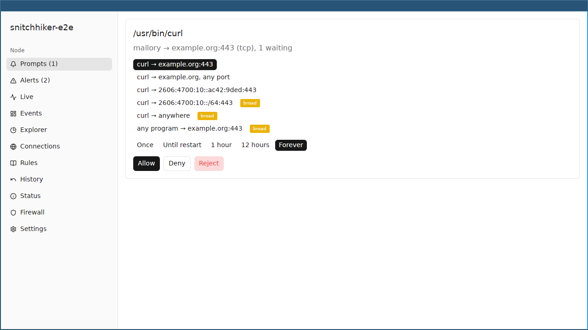

With `no_match = "ask"` in the [configuration](/reference/configuration/#no_match), a connection no rule decides isn't dropped or let through: its first packet is held while the connected clients are asked. The answer decides it, and can leave a rule behind so the question isn't asked again.

The desktop app is the usual way to answer (the Android app will be too); the [command line](/reference/cli/#prompts) can as well.

## In the desktop app



A prompt shows on the **Prompts** page, as a desktop notification (*Allow once*, *Deny*, or a click to open the app) and as a count on the tray icon. The card offers the rules below, narrowest first and chosen; pick one, a duration, and *Allow*, *Deny* or *Reject*. The buttons arm only after a moment, and only in the focused window, so a key or click meant for another window can't answer a prompt that just appeared.

A notification's actions decide only the connections waiting, once: no rule is made from outside the app's window.

## When the daemon asks

A connection is held for a prompt when all of these hold:

- the daemon enforces (`mode = "enforce"`; in monitor mode everything passes and nothing is asked);
- no rule matches the connection;
- `no_match = "ask"`;
- at least one client is listening for prompts.

With nobody listening, `no_client` decides at once (`deny` by default), so a machine nobody is watching doesn't hold connections for the length of a timeout.

## One question per destination

Connections of the same program and user to the same destination, port and protocol share one prompt. A burst of parallel connections, and the retransmitted SYNs of a held one, make one question, and one answer decides all of them. Different questions are independent: a prompt left open doesn't hold up others, and nothing else gets a default answer because something is already being asked.

## What a prompt offers

A prompt says which program, run by which user, connects where, and offers rules from narrowest to broadest:

```text
prompt 7: /home/ada/.local/share/claude/versions/2.0.31/claude (uid 1000 ada) -> api.example.com:443 proto 6, 1 waiting
  0: claude → api.example.com:443
  1: claude → api.example.com, any port
  2: claude → *.example.com:443 (broad)
  3: claude → 192.0.2.10:443
  4: claude → 192.0.2.0/24:443 (broad)
  5: claude → anywhere (broad)
  6: any program → api.example.com:443 (broad)
```

- The **program** is its path with version numbers and hashes replaced by `*` and the user's home by `{home}`. Here: `glob:{home}/.local/share/claude/versions/*/claude`. The rule then survives updates of the program and covers it for every user.
- The **destination** is the name the program itself looked up for the address, or the address when it looked none up.
- The **address** and its network (a /24, or a /64 for IPv6) are offered for services reached by address, or that move between addresses of one range.
- **Broad** suggestions allow more than this destination for this program. The first suggestion is never broad: the quickest answer makes the narrowest rule.

A prompt also warns when the program's executable belongs to a user other than root, or its group or others may write it: a rule for that path covers whatever is written there later.

## Answering

An answer is an action (`allow`, `deny`, `reject`), a duration and the rule to make:

| Duration | The rule |
| --- | --- |
| once | none: only the connections waiting now are decided |
| until restart | lasts until the daemon restarts; never written to disk |
| hour, 12 hours | expires then |
| forever | stays (the default on the command line) |

The rule is made from the chosen suggestion, or from conditions the client gives of its own, in the normal tier.

It goes in the program's folder, `Apps/<program>`, which is scoped to the program: the folder says which program, and its rules say only where it may connect. The folder is made by the first rule for the program and reused by the next ones; programs of the same name at different paths get folders of their own (`python3`, `python3 2`). A rule for any program stays at the top level. A client can name another folder instead. Every listening client is told the prompt was resolved, by whom, and which rule it made, and closes its copy of the question.

```bash
sudo snitchhiker prompts watch                         # print prompts as they open and close
sudo snitchhiker prompts answer 7 allow                # suggestion 0, forever
sudo snitchhiker prompts answer 7 reject --suggestion 5 --duration hour
```

## Timeouts

A prompt waits `prompt_timeout_secs` (30 by default); then `on_timeout` (`deny` by default) decides its connections, without making a rule. The program's own connect timeout may be shorter: a program that gives up before the answer simply retries, and the retry joins the same prompt, or is decided by the rule the answer made.

## In the history

Every connection a prompt decided is recorded as decided by a prompt (with the rule it made, if any) or by a timeout.
