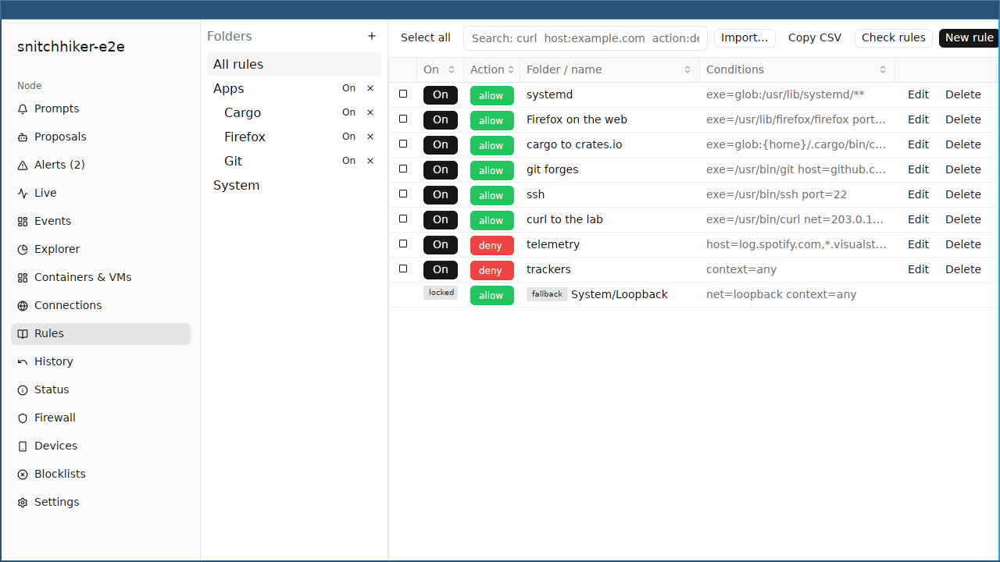

import { Code } from '@astrojs/starlight/components';
import Aliases from '../../../generated/aliases.mdx';
import system from '../../../../../crates/daemon/defaults/system.toml?raw';


A rule is an action and a set of conditions. When every condition holds for a connection, the rule matches it. Rules live in folders; a folder can add conditions to every rule inside it.

```bash
sudo snitchhiker rules
```

```text
    1  allow   normal   curl API  exe = ["/usr/bin/curl"] host = ["api.example.com"] port = ["443"]
    -  allow   fallback (locked) Loopback  net = ["loopback"] context = "any"
```

## Actions

| Action | The connection | The program sees |
| --- | --- | --- |
| `allow` | passes | nothing |
| `deny` | its packet is dropped | a timeout, after its own retries |
| `reject` | its packet is dropped and its socket closed | an error at once (`ECONNABORTED` for TCP) |

`reject` is the kinder block for programs you use interactively: they fail fast instead of hanging. `deny` gives a remote party nothing to observe.

## Conditions

All conditions of a rule must hold. A condition with several values holds when any of them does.

| Condition | Holds when | Example values |
| --- | --- | --- |
| `exe` | the executable's path matches | `/usr/bin/curl`, `glob:{home}/.cargo/bin/*` |
| `cmdline` | the command line (arguments joined by spaces) matches | `re:--remote-debugging-port` |
| `parent` | the executable of any ancestor process matches | `/usr/bin/sshd` |
| `uid` | the process ran as this user (its real user id) when it opened the connection | `1000` |
| `host` | a name the destination address is known by matches | `example.com`, `*.example.org` |
| `net` | the destination address is in the network | `192.0.2.10`, `2001:db8::/32`, `lan` |
| `port` | the destination port is in the range | `443`, `8000-8999` |
| `protocol` | the IP protocol is | `tcp`, `udp`, `icmp`, `icmpv6`, `47` |
| `context` | the process runs in that kind of namespace | `host`, `container`, `netns`, `any` |
| `app` | a stable identity of the program matches | reserved: not yet filled in, so it never matches today |

A rule must have at least one condition: a rule matching every connection is refused. Use the [`no_match` policy](/reference/configuration/#no_match) for that.

### Text patterns

`exe`, `cmdline`, `parent` and `app` take patterns:

- **Exact** by default: `/usr/bin/curl` matches that path only.
- **`glob:`**: `*` matches within one path component (not `/`), `**` across components, `?` one character, `{a,b}` either alternative. `glob:/usr/lib/firefox/{firefox,firefox-bin}`.
- **`re:`**: a regular expression, anchored at both ends. `re:/opt/app-[0-9.]+/bin/app`.

A pattern may start with `{home}`, the home directory of the user whose process is matched: `glob:{home}/.local/share/claude/versions/*/claude` covers that program for every user. Rules made from prompts and by `learn` write paths this way, with version numbers and hashes as `*`, so they survive updates.

For a process in a container, `exe` is the path inside the container.

### Hosts and networks

A `host` pattern is a name (that name only), `*.` and a name (any name below it at any depth, not the name itself), or `re:` and a regular expression matched against the whole name. Names compare case-insensitively, regular expressions included.

Connections are made to addresses, so a `host` condition holds when the address is known by that name. Snitchhiker learns names from the DNS answers processes receive (see [How it works](/internals/how-it-works/#names)). A connection to an address nobody looked up has no name, and no `host` condition holds for it; use `net` for those.

A `net` value is an address, a CIDR range, or an alias:

<Aliases />

### Context

A rule without a `context` condition applies to processes on the host only. Allowing `/usr/bin/curl` then doesn't allow every `curl` in every container. `context = "container"` (a process in another process or user namespace), `"netns"` (the host's, but another network namespace) or `"any"` widens it.

## Folders

Folders group rules and can be switched off as a whole. A folder may have a **scope**: conditions added to every rule inside it. A folder scoped to `exe = ["/usr/bin/git"]` holds rules that only need to say where git may connect.

A rule applies only while it and every folder above it are enabled. Switching a folder off switches off everything inside it; switching it back on restores each rule and folder inside to the state it had.

## Finding and changing many rules



The desktop app's Rules page shows the folder tree beside the rules of the folder chosen (and the folders below it). The search box takes the [query language](/reference/query-language/#keys-for-rules) and filters as you type: `curl`, `host:example.com action:deny`, `enabled:no`, `folder:Apps/*`.

Rules are picked with their check boxes (Shift picks a range) and changed together: enabled or disabled, moved to a folder, given another action, set to expire, or deleted. One change to many rules is one batch in the [history](#history-and-undo), so one undo reverts all of it. Deleting more than 20 rules at once is a [dangerous action](/reference/configuration/#step_up). From the command line: `snitchhiker rules edit 12,13,14 disable`.

## Editing a rule


A rule's *Edit* (or a double-click on it) opens the editor: name, action, tier, folder and conditions. *Check against history* runs the rule as written over the connections the app has loaded and says how many it matches, before anything is saved.

## Checking the rules

*Check rules* in the app (or `snitchhiker rules lint --days 30`) reports:

- **duplicates**: two rules that match exactly the same connections, with the same action;
- **redundant rules**: another rule with the same action, at the same tier or above, already matches everything this one does (`api.example.com` under `*.example.com`);
- **allow rules that never win**: a deny or reject rule at the same tier or above matches everything they do;
- **expired rules**, which no longer apply;
- **unused rules**: they decided no connection in the days asked about and weren't changed in them;
- **replaceable binaries**: an allow rule on a program that a user other than root can change or replace;
- **binaries that are gone**: when an update moved a program to a new versioned path (`…/versions/2.0.40/claude`), the report offers the pattern that covers every version (`…/versions/*/claude`).

A rule is called redundant only when the other rule certainly covers it, judged on the conditions as written (an exact path inside a glob, a network inside a network, a port inside a range): two different globs are never compared.

## Precedence

When several rules match a connection, one decides, by a fixed order:

1. **Tier.** Rules are in one of three tiers: `override`, `normal` (the default) and `fallback`. The highest tier with any matching rule decides; lower tiers aren't looked at.
2. **Blocking beats allowing.** Within that tier, if any matching rule denies or rejects, the connection is blocked.
3. **The most specific rule** is the one recorded as deciding (and its action is the one taken when both `deny` and `reject` match). Each condition adds to a rule's specificity, narrower ones more: an exact path more than a glob, a name more than a wildcard, a longer prefix more than a shorter one, one port more than a range. Equal rules go to the oldest.

So a broad "deny everything to `*.example.com`" in `normal` blocks even where a narrower rule allows, and an `override` rule wins over both. Use `fallback` for defaults that anything more specific should be able to change.

When no rule matches, the [`no_match` policy](/reference/configuration/#no_match) decides.

## Rules that expire

Rules made by answering a prompt can last until the daemon restarts, for an hour, for 12 hours or forever. An expired rule stops matching at once; until-restart rules are never written to disk.

## The System folder

The daemon has one built-in folder, **System**, with a single rule: everything to `loopback` is allowed, in any context, in the fallback tier. Any other rule that matches decides instead. It can't be edited; `default_rules = false` in the [configuration](/reference/configuration/#default_rules) removes it.

<Code code={system} lang="toml" title="The System folder (built into the daemon)" />

## Rule files root keeps

Files in `/etc/snitchhiker/rules.d/*.toml` hold rules a machine's provisioning sets (Ansible, cloud-init): a fleet's baseline. They are in the [rule file format](/reference/rule-files/), read at start and on `systemctl reload snitchhikerd`, and shown to clients as **locked**: they can be seen but not changed or deleted, apart from by editing the file. An invalid file stops the daemon from starting; on a reload, the daemon keeps the rules it had and logs why.

## History and undo

Every change to rules and folders is recorded: who made it (the command line, the desktop app, a prompt's answer, an import), when, and the rule or folder before and after. The changes of one request form a batch: deleting a folder records it and every rule that went with it.

An undo puts a batch back as it was, newest change first, and is recorded itself, so it can be undone too. It is refused when something it would put back was changed again since: undo the later change first.

```bash
sudo snitchhiker history
sudo snitchhiker undo 42
```

## Managing rules from the command line

```bash
# Allow curl to reach one host on 443
sudo snitchhiker rules add allow --exe /usr/bin/curl --host api.example.com --port 443 --name "curl API"

# Block one program everywhere, above every normal rule
sudo snitchhiker rules add reject --exe 'glob:{home}/.local/bin/telemetry-*' --tier override

sudo snitchhiker rules disable 12
sudo snitchhiker rules rm 12
sudo snitchhiker rules export > rules.toml
```

[Command line](/reference/cli/) has every option.
