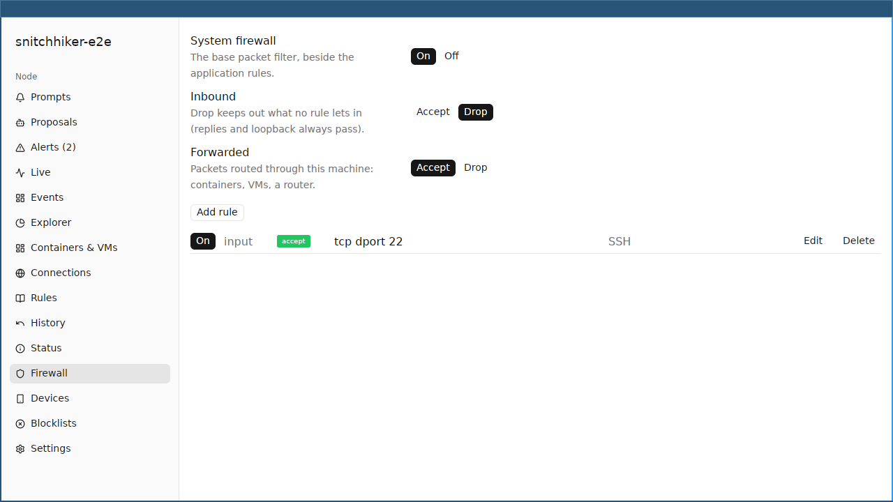

Application rules decide which **programs** may connect out. The system firewall is the other half: a plain packet filter for what comes **in** (and what is routed through the machine), by protocol, address, port, interface and connection state. It lives in its own nftables table, `inet snitchhiker_system`, next to the daemon's.

It starts **off**, with OpenSnitch's defaults ready to use: ICMP and ICMPv6 echo and "unreachable" messages allowed, and four rules present but switched off: SSH from anywhere, loopback addresses, WireGuard's port, and handing forwarded connections to the daemon to decide like an application's.

## Turning it on



In the desktop app, the **Firewall** page: switch it on, set **Inbound** to *Drop* to keep out what no rule lets in, add rules, then **Apply**. Changes are made to a draft and applied together; the node checks them and the kernel installs them in one transaction, so a mistake never leaves the machine half filtered.

With a drop policy, three rules are always added first, as OpenSnitch does: replies to the machine's own connections (and related traffic), the loopback interface, and ICMPv6 (neighbour discovery: IPv6 stops working without it).

```bash
sudo snitchhiker system            # what it is now
sudo snitchhiker system on
sudo snitchhiker system input drop
sudo snitchhiker system export > firewall.toml
```

## Rules

Each rule has a chain (**input**: to this machine, **forward**: routed through it, **output**: from it), a target and any of these matches, all of which must hold:

| Match | |
| --- | --- |
| Protocol | `tcp`, `udp`, `icmp`, `icmpv6`, or a number |
| Source, destination | Addresses or networks (`192.0.2.0/24`, `2001:db8::1`); each source is paired with each destination of its family |
| Source ports, destination ports | One port or a range (`8000-8999`); TCP and UDP only |
| In interface, out interface | A name, or a prefix ending in `*` (`wg*`) |
| Connection state | Any of `new`, `established`, `related`, `invalid` |
| ICMP types | `echo-request`, `echo-reply`, `destination-unreachable`, `time-exceeded`; ICMP and ICMPv6 only |

Targets: **accept**, **drop**, **reject** (ICMP "port unreachable"; a TCP reset for TCP rules), **log** (to the kernel log, then on to the next rule) and **queue** (forward chain only: the daemon decides it as an application connection).

## Changing it from far away

A change that blocks the way you reach the machine locks you out. `snitchhiker system import <file> --trial 60` installs a firewall on trial: unless `snitchhiker system confirm` comes within 60 seconds, the previous one comes back by itself. Remote clients use this for every change.

Every change is in the [history](/guides/rules/#history-and-undo) and can be undone. Turning the firewall off, or the inbound policy from drop to accept, is a [dangerous action](/reference/configuration/#step_up). When the daemon stops with `fail = "open"` (the default), the system table is removed with its own.
